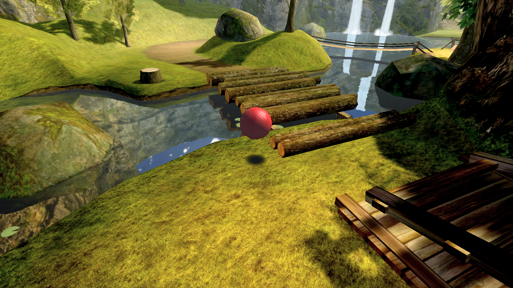
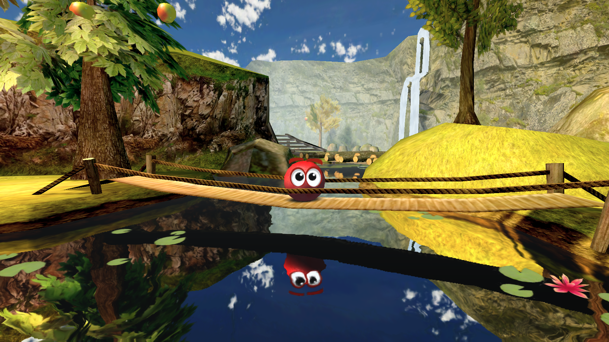
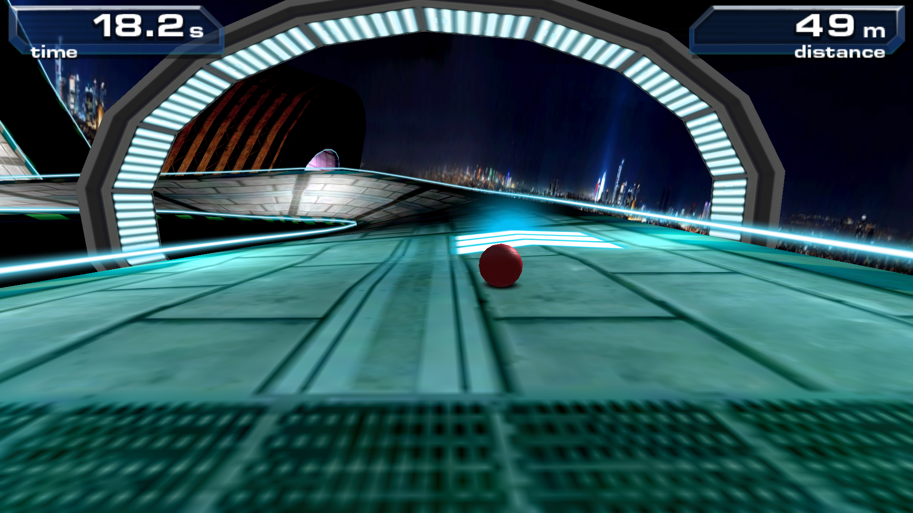

<div align="center">
  
</div>

<div align="center">
  <a href="https://github.com/alox-dev/redbound/releases">
    
  </a>
  <a href="https://discord.gg/WXe65ENvwq">
    
  </a>
  <a href="https://www.youtube.com/@aloxdev">
    
  </a>
  <a href="https://ko-fi.com/aloxdev">
    
  </a>
</div>

<br />

**Redbound** is a source port of **Bounce Evolution**, the 3D tech demo that Rovio Mobile made for the Nokia N900 in 2009. The goal is to free the demo from the N900: the original levels, physics, logic, sounds and menus running natively on modern devices, with modern controls, without emulation.

> [!IMPORTANT]
> **No game data is included.** Redbound contains nothing from the original game. To play, you need your own copy of the original Nokia N900 package (`.deb`); Redbound imports the levels, models, textures, sounds and music from it.

> [!NOTE]
> **Not affiliated with Nokia or Rovio.** Bounce Evolution was developed by Rovio Mobile and published by Nokia. Bounce is a trademark of Nokia. Redbound is an independent, non-commercial fan project.

<br />

<div align="center">
  
  
  
</div>

---

## How this project was made

Redbound was written with the help of **Claude** (Anthropic). The original binary and data formats were studied, and the game logic, physics, renderer, audio, menus and platform layers were reimplemented with AI assistance. The project is directed, reviewed, tested on real hardware and maintained by **Alox**, who checks every change before it lands. The AI involvement is stated openly here and in the in-game About screen.

---

## Features

**The original game**
- Attraction demo, main menu, credits and pause menu, with the original sprites and fonts.
- Level 1: the countryside level with its 14 apples, cutscenes, log puzzle and results card.
- Level 2: the arcade rail level, with boost arrows, slow zones, time arcs, falls and the top three records.
- Music, ambient sounds and effects, as in the original.

**Added by the port**
- Import screen: choose your `.deb` and the game data is extracted and verified (SHA-256) automatically.
- Port menu, an overlay above the game (built with Dear ImGui) with game, controls, graphics, audio, improvements and about sections, in English and Spanish (more languages can be added without recompiling).
- Every input device listed below, detected automatically (the accelerometer is turned on by hand).
- Optional: level sections always visible (the N900 hid far parts of the level to save memory).
- Fixes: the butterfly is animated during play, Bounce's eyes are hidden behind foliage, transparency sorting.

---

## Platforms

| Platform | Status |
| :--- | :--- |
| **Linux** (x86_64) | Supported |
| **Android** 11 or newer (arm64) | Supported |
| **Windows** (x86_64) | Supported |

---

## Input support

| Input | How it works |
| :--- | :--- |
| **Keyboard only** | Classic tank controls: W/S or arrows move, A/D turn, Space jumps |
| **Keyboard and mouse** | Moving the mouse captures the cursor and rotates the camera, no button needed; W/A/S/D move relative to the camera |
| **Numeric & phone keypads** | 8/2/4/6 move, 5 or 0 jump (also phones with physical keys) |
| **Xbox & XInput controllers** | d-pad: classic controls; left stick: camera relative movement; right stick: camera; both navigate the menus |
| **PlayStation, Switch, 8BitDo** | Same as above, via SDL_GameControllerDB; unknown controllers work as generic joysticks |
| **Touch** | One finger swipes to move and holds a side to turn the camera; a second finger moves the camera; double tap jumps |
| **Accelerometer** *(experimental)*| Turned on in the port menu: tilt to move (like the N900), shake to jump |
| **Vibration** | Phone vibration and controller rumble where the original N900 vibrated |

---

## Getting started

1. Get your own copy of the original package, `Bounce_Evolution.deb` (for example, from your N900 or your own backup of it). The supported version has this SHA-256 (check it with `sha256sum Bounce_Evolution.deb`):
   ```text
   09e0b3abc8c422ffaa3a2fca7e796749d6ad6797137b840d84e28938c6401ab4
   ```
   *Other versions are imported too, with a warning that they may not work correctly.*
   
2. Download Redbound for your platform from the [releases page](https://github.com/alox-dev/redbound/releases):
   * The `.AppImage` for Linux (make it executable with `chmod +x` and open it)
   * The `.zip` for Windows (extract it and run `redbound.exe`)
   * The `.apk` for Android
   *(You can also build it yourself as described below).*
   
3. Start Redbound. The import screen opens: choose your `.deb`. On Android you can also copy it to `Android/data/io.github.alox_dev.redbound/files` over USB.
4. Play. The demo starts; tap, click or press Start to open the main menu and pick a level.

---

## How to play

- **Attraction demo**: the original self-running demo of level 1.
- **Level 1**: roll through the countryside and collect all 14 apples.
- **Level 2**: race along the rails for as long as the timer lasts. Arrows boost you, arcs add time, barriers slow you down. Your distance is compared with the records.

### Controls

| Action | Keyboard | Controller | Touch |
| :--- | :--- | :--- | :--- |
| **Pause** (original menu) | `P` or click top left | `Start` / `+` | Tap top left corner |
| **Port menu** | `Esc` | `Back` / `View` / `-` | Three finger tap, or Android Back |

> The port menu pauses the game. Its sections include:

| Section | Contents |
| :--- | :--- |
| **Game** | Game data folder, import another `.deb`, language |
| **Controls** | Camera sensitivity, invert Y, stick dead zone, vibration, connected controllers, experimental accelerometer |
| **Graphics** | Vertical sync, fullscreen, current resolution |
| **Audio** | Mute and volume |
| **Improvements** | Port changes that can be turned off |
| **About** | Version, credits, community links, libraries, license |

Settings are saved in `~/.config/redbound/config.ini` (inside the app's storage on Android). See `docs/port-menu.md` and `docs/controls.md` for details.

---

## Building

Full instructions are in [`docs/building.md`](docs/building.md).

**Linux** (CMake 3.16+, GCC or Clang with C++17, SDL2, OpenGL ES 2 headers, zlib, git):
```bash
./scripts/setup-ka3d.sh
cmake -S . -B build -G Ninja
cmake --build build
ctest --test-dir build
./build/app/redbound
```

**Windows** (cross compiled from Linux with MinGW-w64; runs on Direct3D 11 through ANGLE):
```bash
sudo apt install mingw-w64 libz-mingw-w64-dev zip imagemagick
./scripts/package-windows.sh
```

**Android** (JDK 17 or 21, Android SDK with NDK 26.1 and CMake 3.22.1):
```bash
./scripts/setup-ka3d.sh
./scripts/setup-sdl2.sh
cd platforms/android
echo "sdk.dir=$ANDROID_HOME" > local.properties
./gradlew assembleDebug
```

---

## Tested on

| Device | Platform |
| :--- | :--- |
| ASUS X512JA laptop (Intel Iris Plus) | Debian 13 |
| AYN Thor Pro (Snapdragon 8 Gen 2, 12 GB RAM) | Android 13 |
| Duoqin F22 Pro (physical keypad) | Android 11 |
| Samsung Galaxy Note 10+ | Android 12 |
| HP Z230 Workstation | Windows 10 (Virtualized on Debian 13 through VMware Workstation 17 Pro - 1 CPU 4 cores 8GB Memory) |


---

## Repository structure

| Path | Contents |
| :--- | :--- |
| `app/` | The game executable: level session, input, level menu, HUD, sky, devices, launch options |
| `game/` | Platform independent core: trigger interpreter and actions, ball physics, rails, with unit tests |
| `port/` | Platform layer: scene world and ball controller, OpenGL ES 2 renderer, audio, 2D UI, port menu, `.deb` importer |
| `engine/` | Build of the KA3D engine (cloned into `third_party/ka3d` by `scripts/setup-ka3d.sh`) |
| `platforms/` | Platform projects and packaging: `android/` (Gradle app), `linux/` (desktop entry) |
| `cmake/` | Toolchain files (MinGW-w64 for Windows) |
| `assets/` | Files shipped with the game: port menu languages (`lang/`) |
| `scripts/` | Setup scripts for KA3D and SDL2 |
| `tools/` | Development tools: `hgr-dump` (scene inspector), `pvr2png` (texture converter), binary analysis scripts |
| `third_party/` | Bundled dependencies and the KA3D patch |
| `docs/` | Technical documentation |

---

## Documentation

| Document | Contents |
| :--- | :--- |
| [`docs/building.md`](docs/building.md) | Building and packaging for each platform |
| [`docs/architecture.md`](docs/architecture.md) | Modules, program flow, level sessions, audio, 2D interface |
| [`docs/controls.md`](docs/controls.md) | Input devices, control schemes, touch and accelerometer in detail |
| [`docs/port-menu.md`](docs/port-menu.md) | Port menu sections, configuration keys, adding languages |
| [`docs/gameplay.md`](docs/gameplay.md) | Ball physics, camera, level 1 and the level 2 rail mode |
| [`docs/level-format.md`](docs/level-format.md) | The `.hgr` levels, user properties, triggers and their 88 actions |
| [`docs/rendering.md`](docs/rendering.md) | OpenGL ES 2 renderer, effects, lightmaps, water, sky, KA3D patch |

---

## Community

- **Discord**: https://discord.gg/WXe65ENvwq
- **YouTube**: https://www.youtube.com/@aloxdev
- **GitHub**: https://github.com/alox-dev/redbound

## Contributing

Issues and pull requests are welcome; read [`CONTRIBUTING.md`](CONTRIBUTING.md) first. Pull requests target the `develop` branch and are reviewed before merging. AI assisted contributions are accepted when stated and fully reviewed by their author.

## Support

If you enjoy Redbound and want to support its development, you can do so on [Ko-fi](https://ko-fi.com/aloxdev). Thank you!

---

## Credits

- **Alox**: project direction, review, testing and maintenance.
- **Claude** (Anthropic): AI assistant used to write the code and documentation.
- **Rovio Mobile** and **Nokia**: the original Bounce Evolution (2009).
- **Jani Kajala**: the KA3D engine.
- **Libraries**: SDL2, Dear ImGui, dr_libs, stb, the PVRTC decompressor by Imagination Technologies, SDL_GameControllerDB and zlib.

## License

Redbound is licensed under the [GNU General Public License v2](LICENSE), the license of the KA3D engine it is built on. Bundled libraries keep their own licenses: Dear ImGui (MIT), dr_libs (public domain / MIT-0), stb (public domain / MIT), PVRTC decompressor (MIT), SDL_GameControllerDB (zlib); SDL2 (zlib) and, on Windows, ANGLE (BSD) are downloaded by the setup scripts. 

Bounce Evolution and its data remain property of their owners.